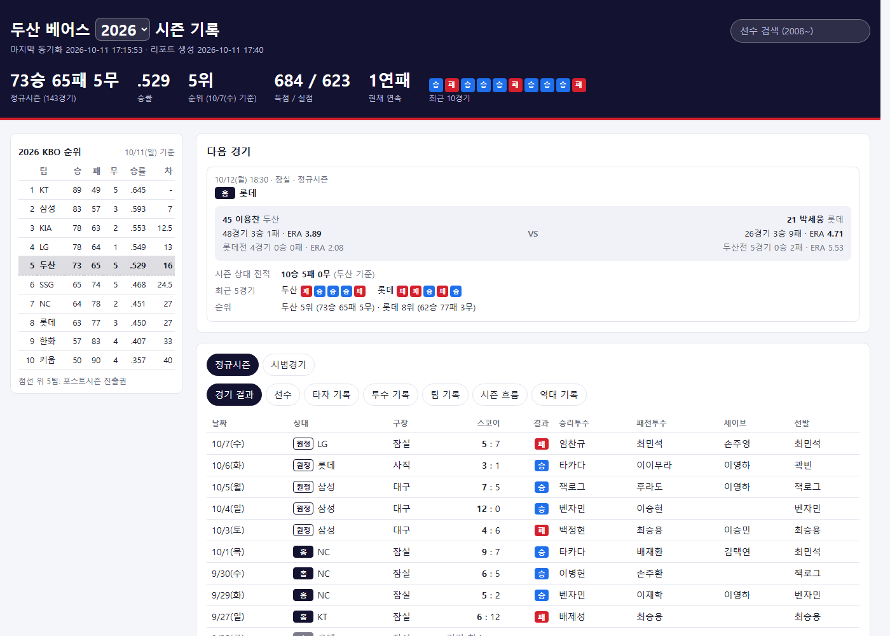
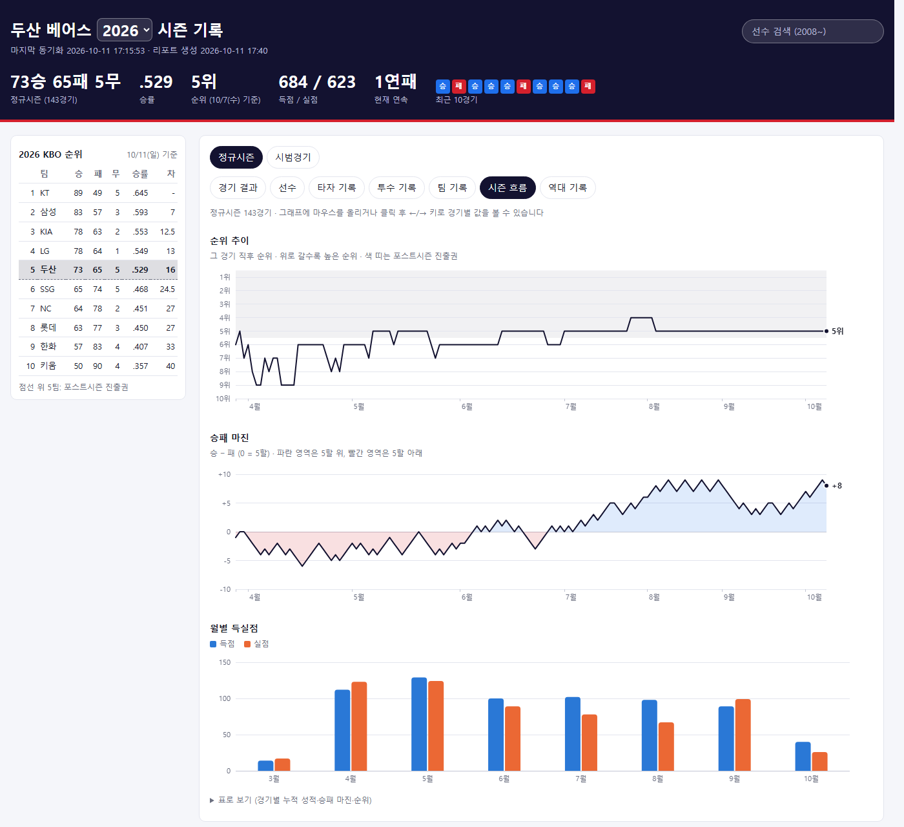

# 두산 베어스 기록 자동 수집기

[](https://github.com/pcw7/doosan-bears/actions/workflows/sync.yml)

두산 베어스 경기가 끝날 때마다 경기 결과와 선수 기록을 자동으로 모아 웹 대시보드로 보여주는 개인 팬 프로젝트입니다.
경기 시간대(한국시간 17:05~01:45)에 20분마다 새 경기를 확인해 수집하고, GitHub Pages에 배포합니다.

**대시보드: https://pcw7.github.io/doosan-bears/** (2008년~현재, 시즌마다 페이지)

| 메인 화면 | 시즌 흐름 탭 |
|---|---|
|  |  |

## 화면

| 위치 | 내용 |
|---|---|
| 상단 | 시즌 성적(승패·승률·순위·득실·연속), 최근 10경기, **시즌 선택**, **선수 검색** |
| 왼쪽 | **KBO 리그 순위표** (넓은 화면에서 스크롤을 따라다님, 좁은 화면에선 본문 위에 접힘) |
| 다음 경기 | **선발 투수 매치업**(시즌·상대 전적), 시즌 상대 전적, 양 팀 최근 5경기, 순위 |
| 경기 결과 탭 | 경기 목록(20경기씩 더보기), 누르면 박스스코어(이닝별 점수·타자·투수·결승타 등) |
| 선수 탭 | **팀 내 1위** 카드, 포지션별·등번호순 선수 카드(사진·번호·주요 기록) |
| 타자 / 투수 기록 탭 | 시즌 누적 기록 표 (열 제목으로 정렬, 규정타석·규정이닝 필터) |
| 팀 기록 탭 | 팀 타격·수비, 투수진(선발/불펜), 상황별·상대 팀별·월별 성적, 역전승/역전패 |
| 시즌 흐름 탭 | 정규시즌 **순위 추이**, **승패 마진**(승−패), **월별 득실점** 그래프 (마우스·←/→ 키로 경기별 값, 표로 보기) |
| 역대 기록 탭 | **시즌별 팀 성적**(순위·포스트시즌 결과), **한 시즌 개인 기록** 상위 5명 (2008년~) |
| 선수 기록 창 | 이름·카드를 누르면 프로필(번호·생년월일·키/몸무게·출신·드래프트·WAR)과 경기별 기록 |

- 정규시즌 / 포스트시즌 / 시범경기를 탭으로 나눠 봅니다.
- 포스트시즌 경기에는 "와일드카드 2차전"처럼 차전과 그 경기까지의 시리즈 전적이 붙습니다. 와일드카드는 4위 팀의 1승 어드밴티지를 포함합니다.
- 포스트시즌 결과(탈락·다음 라운드 진출·진행 중)는 시리즈 전적으로 판단합니다. 그래서 다음 라운드 일정이 아직 안 나왔거나, 필요 없어진 "필요 시" 경기가 일정에 남아 있어도 맞게 표시됩니다. 일정에서 빠진 예정 경기는 DB에서도 지웁니다.
- 시즌 중 다른 팀에서 온 선수는 **"이적"** 배지가 붙고, 두산 기록과 공식 시즌 기록을 함께 보여줍니다.
- 다른 시즌의 선수 기록 창으로 바로 가는 주소: `<시즌>.html#p=<선수ID>` (검색·역대 기록에서 사용)

## 동작 방식

```
cron-job.org — 한국시간 매일 17:05 ~ 01:45, 20분마다 GitHub에 "실행" 요청 (코드 push 때, 수동 실행 때도 실행)
 ↓
GitHub Actions
 ┌ 수집 작업 (collect)
 │   원본에서 DB 복원 → 네이버에서 두산 일정 확인
 │   → 새로 끝난 경기의 박스스코어 저장 → 새 경기 출전 선수의 등번호·프로필 갱신
 │   → 리그 순위표 갱신 → 다음 경기 미리보기 → 19개 시즌 웹페이지 생성
 │   → 바뀐 데이터만 커밋 ("기록 추가: 1경기" / "선수 정보·순위 갱신")
 └ 배포 작업 (deploy) → GitHub Pages
```

- 실행 시각은 외부 무료 서비스 **cron-job.org**가 정합니다. GitHub 자체 예약 실행은 실측 결과 약 75%가 빠지고 최대 5시간씩 늦어서 쓰지 않습니다.
- 수집과 배포를 나눠서, 배포가 멈춰도 수집은 계속됩니다. 멈춘 배포는 다음 배포가 취소하고 대신합니다.
- 바뀐 게 없으면 커밋하지 않습니다. 경기가 없는 시간에도 배포는 해서 "다음 경기"(선발 발표 등)와 "진행 중" 표시는 실행할 때마다 갱신됩니다.
- 자동 커밋은 저장소 주인 계정(noreply 이메일)으로 해서 GitHub 잔디에 기록됩니다.

## 데이터 출처

모든 데이터는 **네이버 스포츠**(`api-gw.sports.naver.com`)에서 가져옵니다. 공식 공개 API가 아니어서 예고 없이 바뀔 수 있습니다.

| 용도 | 주소 |
|---|---|
| 경기 일정·결과 | `/schedule/games?…` |
| 박스스코어 | `/schedule/games/{경기ID}/record` |
| 등번호 (문자중계 출전 명단) | `/schedule/games/{경기ID}/relay` |
| 다음 경기 미리보기 | `/schedule/games/{경기ID}/preview` |
| 선수 프로필·WAR | `/statistics/categories/kbo/seasons/{시즌}/players/{선수ID}` |
| 리그 순위표 | `/statistics/categories/kbo/seasons/{시즌}/teams` |
| 선수 사진 | `ssl.pstatic.net` 이미지 주소를 화면에서 바로 불러옴 (저장하지 않음) |

| 항목 | 기준 |
|---|---|
| 등번호, 포지션(가장 많이 맡은 수비 위치), WAR | 그 시즌 |
| 사진·생년월일·키/몸무게·투타·출신·드래프트·연봉 | 현재 (연봉은 진행 중 시즌의 현 두산 선수만 표시) |
| 순위표 | 정규시즌 승률 기준 (네이버의 지난 시즌 순위는 포스트시즌까지 반영한 최종 순위라 다시 계산) |

## 저장 구조

| 위치 | 내용 | 커밋 |
|---|---|---|
| `data/games/<시즌>/<경기ID>.json.enc` | 경기별 원본 (한 번 저장하면 바뀌지 않음) | ✅ 암호화 |
| `data/players/<시즌>.json.enc` | 시즌별 선수 등번호·프로필 | ✅ 암호화 |
| `data/standings/<시즌>.json.enc` | 시즌별 리그 순위표 | ✅ 암호화 |
| `data/doosan.db` | 원본을 표로 정리한 SQLite (경기·타자·투수) | ❌ 원본에서 언제든 다시 만듦 |
| `reports/` | 웹페이지(`index.html`, `<시즌>.html`)와 CSV(`reports/csv/`) | ❌ 실행할 때마다 만듦 |

- 원본은 gzip 압축 후 암호화(Fernet)해서, 네이버 응답을 공개 저장소에 그대로 배포하지 않습니다.
- DB 구조를 바꾸면 `db.py`의 `SCHEMA_VERSION`을 올립니다. 기존 DB를 지우고 원본에서 자동으로 다시 만듭니다.
- 다음 경기 미리보기는 자주 바뀌어 커밋하지 않고 DB에만 둡니다.

## 암호 키

| 위치 | 용도 |
|---|---|
| 프로젝트 폴더의 `archive.key` | 내 PC에서 실행할 때 (git에 올라가지 않음) |
| 저장소 Settings → Secrets → `DOOSAN_ARCHIVE_KEY` | GitHub Actions에서 |

**키를 잃어버리면 저장된 원본을 복구할 수 없습니다.** `archive.key` 내용을 비밀번호 관리자 등 안전한 곳에 따로 보관하세요.
다른 PC에서는 저장소를 받은 뒤 같은 키를 `archive.key` 파일로 두면 됩니다.

## 내 PC에서 실행하기

```powershell
pip install -r requirements.txt          # 처음 한 번 (암호화용 cryptography)
git pull                                 # Actions가 수집한 최신 데이터 받기
python -m doosan_tracker report          # reports/ 에 웹페이지·CSV 생성 (브라우저로 reports/index.html 열기)
python -m doosan_tracker status          # DB 현황
python -m doosan_tracker sync            # 새 경기 수집 + 리포트 (보통은 Actions가 함)
python -m doosan_tracker sync --from 2025-03-01 --to 2025-11-30   # 기간 지정 수집
python -m doosan_tracker info --all      # 모든 시즌 선수 정보·순위표 다시 채우기
```

자동 수집은 Actions가 맡습니다. PC에서 `sync`를 정기적으로 돌리면 같은 파일을 두 곳에서 만들어 `git pull` 때 충돌하니 피하세요.
직접 수집한 데이터는 `data/`를 커밋하고 push하면 Actions에도 반영됩니다.

## 관리와 문제 해결

- **지금 바로 수집:** 저장소 **Actions → 경기 기록 수집 & 배포 → Run workflow**
- **실패 알림:** 실행이 실패하면 GitHub가 메일로 알려줍니다. Actions 실행 기록에서 로그를 확인하세요.
- **실행이 'waiting'으로 멈춤:** 2026-10-07에 배포 환경이 대기 상태로 4일간 멈춘 적이 있습니다(현재는 수집·배포 분리로 수집은 영향 없음).
  Actions에 오래 멈춘 실행이 보이면 Cancel workflow로 취소하세요. 밀린 경기는 다음 실행이 한꺼번에 받습니다.
- **정시 실행 (cron-job.org):** 작업 `doosan-bears 수집`이 아래 주소로 POST 요청(본문 `{"ref":"main"}`)을 보냅니다.
  `https://api.github.com/repos/pcw7/doosan-bears/actions/workflows/sync.yml/dispatches`
  - 헤더 `Authorization: Bearer <토큰>`의 토큰은 **이 저장소의 Actions 실행 권한만 가진 Fine-grained 토큰**(`doosan-cron`)입니다. 코드·데이터는 건드릴 수 없습니다.
  - **토큰은 만료일이 있습니다.** 만료되면 cron-job.org 실행이 401로 실패하니, GitHub에서 새로 만들어 cron-job.org 헤더만 바꾸면 됩니다.
  - 토큰 사본은 이 PC의 `.env`(git에 올라가지 않음)에 보관합니다.
  - cron-job.org의 "실패 시 알림"을 켜 두면 토큰 만료 등 문제가 생길 때 메일이 옵니다.
  - 비시즌(11~2월)에는 cron-job.org에서 작업을 꺼 둬도 됩니다. 켜 둬도 바뀐 게 없으면 커밋 없이 끝납니다.
- **네이버 구조 변경:** 수집이 계속 실패하면 `naver.py`(요청)와 `parse.py`(해석)를 응답에 맞게 고칩니다. 이미 받은 기록과 사이트는 그대로 남습니다.

## 데이터 한계와 검증

선수 기록은 **두산 경기만** 합칩니다. 시즌 중 이적해 온 선수는 공식 시즌 기록과 경기마다 비교해 찾아내고(두산 경기의 80% 이상에서 어긋날 때),
서스펜디드 경기나 일부 자료 누락처럼 잠깐 어긋나는 경우는 제외합니다.

네이버 자료에 빠진 부분은 다른 정보로 채우거나 화면에 안내합니다.

| 시기 | 빠진 것 | 처리 |
|---|---|---|
| 2024년 이전 | 타자별 도루 수 | 경기 기록 문구('도루: 이종욱2 …')에서 채움 (2025~2026년 306경기에서 일치 확인) |
| 옛 포스트시즌·시범경기 | 일부 홈런 수 | 타석 결과('우홈' 등)로 보정 |
| 옛 시즌 | 선발투수 이름 | 박스스코어의 첫 투수로 채움 |
| 2008년 포스트시즌 7경기 등 | 선수 기록 전체 | 점수·이닝별 점수만 표시, 화면에 안내 |
| 2011년 정규시즌 | 개인 투수 기록 | 팀 ERA는 박스스코어 팀 합계로 계산, 화면에 안내 |
| 2008~2010년 | 팀 투구 합계 | 팀 ERA를 개인 기록 합으로 계산 (공식과 0.01~0.02 차이) |
| 2016년까지 | 세부 지표(WAR) | 표시하지 않음 (2017년부터 표시) |

2026-10-06 기준 검증 결과:
- 2008~2026년 모든 시즌의 정규시즌 승·패·무, 팀 타율, 팀 홈런, 최종 순위가 공식 기록과 일치
- 팀 ERA는 2009·2010년(위 한계)을 빼고 모두 일치
- 2026년 선수별 시즌 타율·ERA·승패·세이브가 공식 기록과 모두 일치

## 구성

사용 기술: Python 3.12 (표준 라이브러리 + `cryptography`), SQLite, GitHub Actions, GitHub Pages, cron-job.org.
웹페이지는 HTML 파일 하나에 데이터를 넣어 만들고, 그래프는 차트 라이브러리 없이 SVG로 직접 그립니다.

```
doosan_tracker/
  naver.py      네이버 스포츠 API 호출
  archive.py    원본 암호화 보관 (data/games, data/players, data/standings)
  parse.py      원본 → 경기/타자/투수 행 (2루타·3루타·사구·희생타·도루 보정 포함)
  db.py         SQLite 스키마와 저장
  sync.py       원본에서 DB 복원 → 새로 끝난 경기만 수집
  players.py    선수 등번호(문자중계 명단)·프로필·WAR
  league.py     리그 순위표 (정규시즌 기준으로 다시 계산)
  preview.py    다음 경기 미리보기
  stats.py      시즌·팀·역대 기록 집계, 이적 선수 판별
  export.py     CSV 내보내기
  report.py     웹페이지 생성 (templates/report.html)
.github/workflows/sync.yml   자동 수집 + Pages 배포
docs/                        README 화면 캡처
```

## 이용 안내

비상업적 개인 팬 프로젝트입니다. 경기 기록과 선수 정보·사진의 출처는 네이버 스포츠이며, 권리는 각 권리자에게 있습니다.
